<div align="center">

# Flight Data Platform

**Data-платформа для анализа воздушного движения в реальном времени**<br>
от ADS-B сигнала самолёта до вопроса к ИИ-агенту на локальной LLM

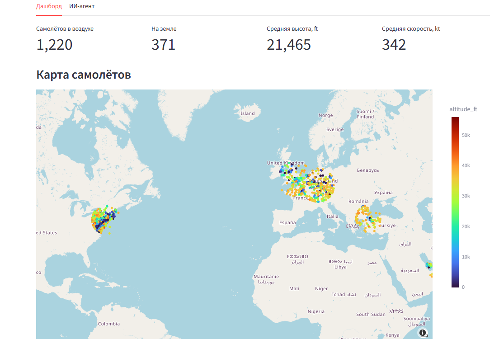

</div>

## О проекте

Платформа каждую минуту забирает живые данные о самолётах из открытого ADS-B API, прогоняет их через Kafka и Spark,
складывает в lakehouse на Delta Lake по слоям **bronze → silver → gold** и превращает в аналитические витрины.
Поверх витрин работают дашборд и ИИ-агент: он понимает вопросы на русском, сам строит SQL и отвечает только по данным платформы.

Проект учебный (дисциплина «Проектирование систем обработки больших данных», НИТУ «МИСИС»), но собран как настоящий pet-проект:
всё поднимается одной командой, данные не берутся из готового файла, а приходят из внешнего источника.

**Что внутри**

- живой источник: [adsb.lol](https://adsb.lol), 6 регионов, около 1500 событий за цикл опроса
- Kafka в режиме KRaft (без Zookeeper), Kafka UI для наблюдения
- Spark Structured Streaming + batch, идемпотентная загрузка через `MERGE`
- Lakehouse: Delta Lake на S3-совместимом SeaweedFS
- Airflow: конвейер запускается каждые 10 минут, справочник аэропортов обновляется раз в сутки
- 7 витрин слоя gold, дашборд на Streamlit с картой
- ИИ-агент: text-to-SQL на локальной `qwen3:8b` через Ollama, поддержка видеокарты с 6 ГБ

## Архитектура

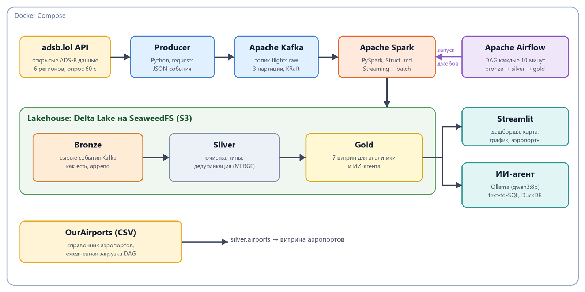

| Требование ТЗ            | Реализация                                                          |
|--------------------------|---------------------------------------------------------------------|
| Lakehouse по слоям       | Delta Lake на SeaweedFS (S3): bronze / silver / gold                |
| Движок обработки         | Apache Spark (PySpark, Structured Streaming + batch)                |
| Брокер сообщений         | Apache Kafka (KRaft) + Kafka UI                                     |
| Оркестрация              | Apache Airflow                                                      |
| Внешний источник данных  | adsb.lol (ADS-B, живые данные) + справочник аэропортов OurAirports  |
| Витрины                  | Delta-таблицы слоя gold                                             |
| ИИ-агент                 | Streamlit + Ollama (qwen3:8b), запросы к витринам через DuckDB      |

## Как это работает

### 1. Сбор данных и Kafka

Продюсер ([`producer/producer.py`](producer/producer.py)) опрашивает шесть регионов с плотным движением
(Франкфурт, Лондон, Стамбул, Нью-Йорк, Дубай, Сингапур) и публикует состояние каждого самолёта отдельным JSON-событием
в топик `flights.raw`. Ключ сообщения: ICAO24 борта, поэтому события одного самолёта попадают в одну партицию и не теряют порядок.

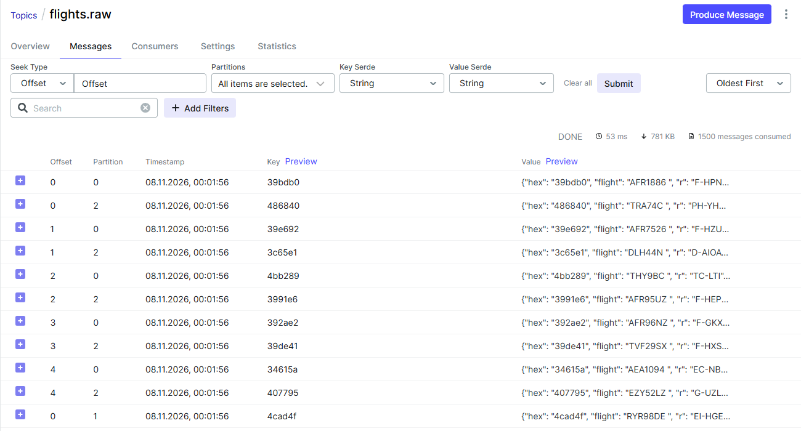

### 2. Lakehouse: три слоя

| Слой       | Что хранит                                                       | Как строится                                            |
|------------|------------------------------------------------------------------|---------------------------------------------------------|
| **bronze** | сырые события Kafka как есть, плюс партиция, смещение, время     | Structured Streaming, режим `availableNow`, append      |
| **silver** | типизированные позиции: разбор JSON, фильтры, дедупликация       | потоковое чтение bronze, `MERGE` по (борт, время позиции) |
| **gold**   | 7 витрин для аналитики и агента                                  | batch-пересчёт из silver                                |

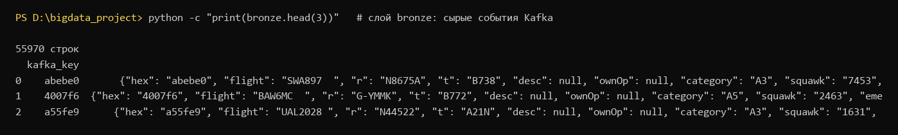
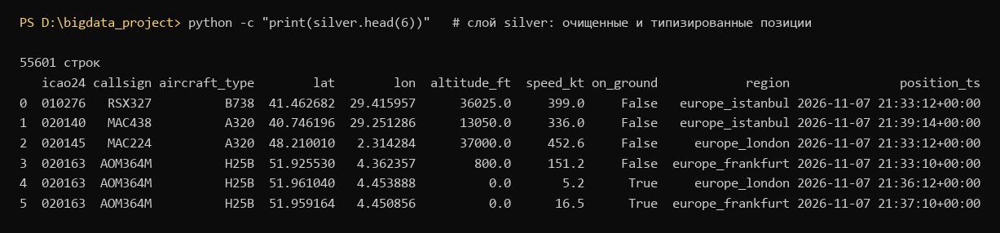

### 3. Оркестрация

DAG `flights_lakehouse_pipeline` запускается каждые 10 минут и последовательно выполняет `bronze_ingest → silver_transform → gold_marts`.
Параллельные запуски запрещены, неудачные задания перезапускаются. DAG `reference_airports` раз в сутки обновляет справочник аэропортов.

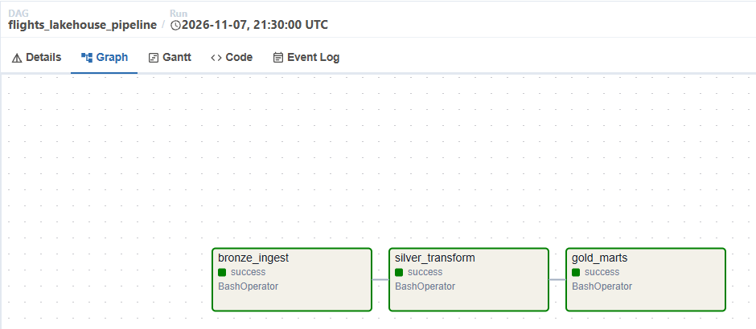

### 4. Витрины (gold)

| Витрина                    | Содержание                                              |
|----------------------------|---------------------------------------------------------|
| `mart_live_aircraft`       | текущие позиции самолётов за последние 10 минут          |
| `mart_traffic_region_hour` | почасовой трафик по регионам                             |
| `mart_airline_activity`    | борты и рейсы авиакомпаний по дням                       |
| `mart_aircraft_types`      | статистика по типам воздушных судов                      |
| `mart_aircraft_daily`      | сводка по каждому борту за день                          |
| `mart_emergency_events`    | аварийные сигналы (squawk 7500 / 7600 / 7700)            |
| `mart_airport_activity`    | прилёты и вылеты у аэропортов (справочник OurAirports)   |

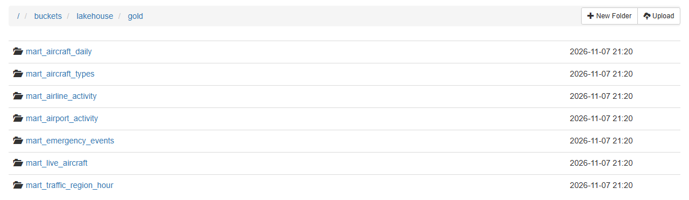

### 5. Дашборд

Приложение на Streamlit читает витрины напрямую из Delta-таблиц на S3 (без Spark): показатели, карта самолётов, окрашенных по высоте,
трафик по регионам, популярные типы, авиакомпании и загруженность аэропортов.

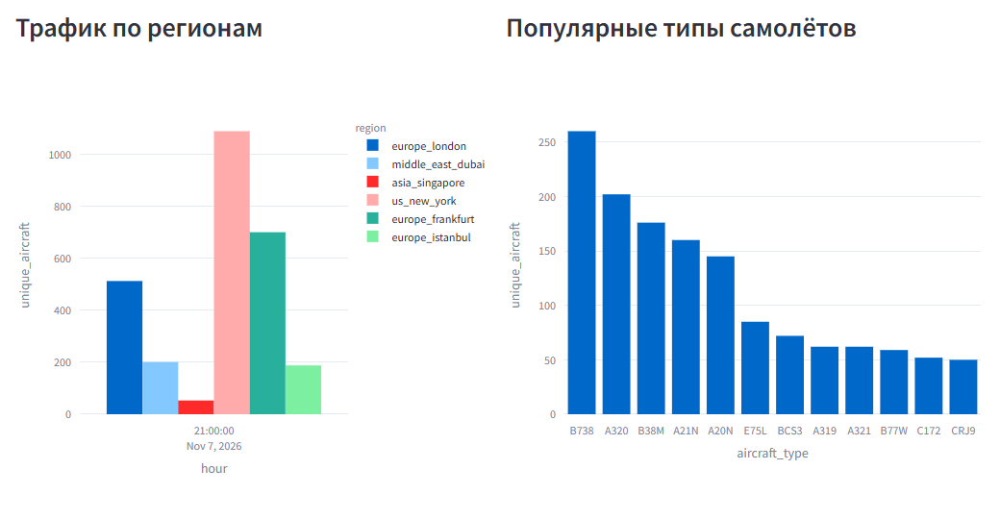

### 6. ИИ-агент

Агент работает по схеме **text-to-SQL**: вопрос и описание витрин попадают в локальную модель, она пишет SQL,
запрос проверяется (разрешён только `SELECT`), выполняется в DuckDB по витринам gold, а ответ формулируется строго по полученной таблице.
При ошибке запроса агент один раз пытается исправить его сам. Модель не придумывает данные: источник знаний, это витрины платформы.

<table>
<tr>
<td width="50%">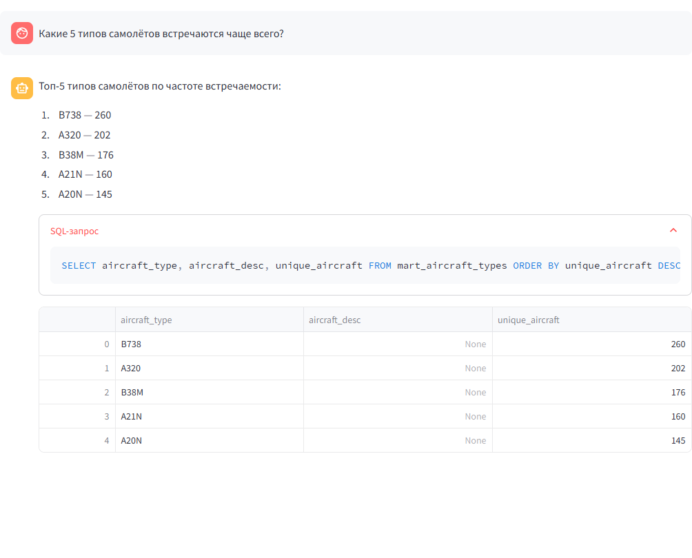</td>
<td width="50%">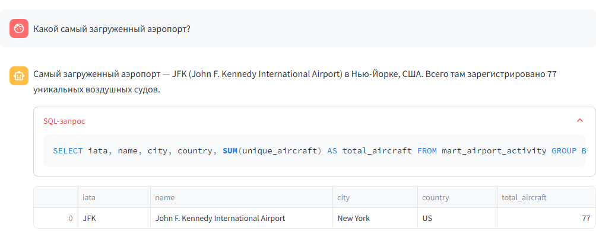</td>
</tr>
</table>

Примеры вопросов: «Сколько сейчас самолётов в воздухе по регионам?», «Какая авиакомпания имеет больше всего бортов?»,
«Какой самый загруженный аэропорт?», «Были ли аварийные сигналы?».

## Быстрый старт

**Нужно:** Docker Desktop (для стека выделите Docker не менее 8 ГБ ОЗУ) и [Ollama](https://ollama.com) с моделью:

```bash
ollama pull qwen3:8b
```

Для видеокарты с 6 ГБ памяти, если `qwen3:8b` тесна, подойдёт `qwen3:4b-instruct` (укажите её в `OLLAMA_MODEL`).

```bash
git clone https://github.com/MISiSpalppv/flight_data_platform.git
cd flight_data_platform
cp .env.example .env
```

Замените `AIRFLOW_FERNET_KEY` в `.env` на свой ключ:

```bash
python -c "import base64,os;print(base64.urlsafe_b64encode(os.urandom(32)).decode())"
```

```bash
docker compose up -d --build
```

Через 5–10 минут пройдёт первый запуск DAG, и витрины появятся в gold.

| Сервис          | Адрес                  | Доступ                                                    |
|-----------------|------------------------|-----------------------------------------------------------|
| Дашборд и агент | http://localhost:8501  |                                                           |
| Airflow         | http://localhost:8081  | `AIRFLOW_ADMIN_USER` / `AIRFLOW_ADMIN_PASSWORD` из `.env` |
| Kafka UI        | http://localhost:8080  |                                                           |
| Файлы lakehouse | http://localhost:8888  | каталог `buckets/lakehouse`                               |

<details>
<summary>Скриншоты Airflow</summary>

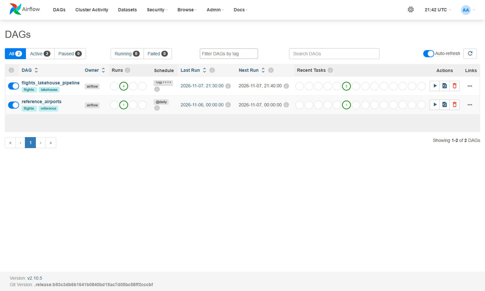
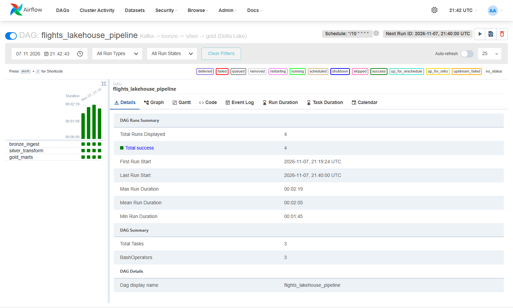

</details>

## Структура репозитория

```
producer/        продюсер: ADS-B API -> Kafka
spark_jobs/      Spark-задания: bronze_ingest, silver_transform, gold_marts, ref_airports
airflow/dags/    DAG-и оркестрации
app/             Streamlit-приложение и ИИ-агент (agent.py, lake.py)
docker/          Dockerfile и вспомогательные файлы сервисов
docs/img/        иллюстрации для README
report/          генераторы скриншотов, отчёта и презентации
```

## Заметки и ограничения

- Расчёт слоя gold полный (витрины перезаписываются целиком), для масштаба учебного проекта этого достаточно.
- Данные adsb.lol зависят от покрытия ADS-B приёмников: над частью регионов самолётов видно меньше (например, над Россией).
- Агент использует небольшую локальную модель, поэтому на нестандартные формулировки может ошибаться;
  в промпт добавлены примеры запросов к витринам, а SQL всегда показывается рядом с ответом.
- Для S3 используется SeaweedFS: официальные образы MinIO больше не публикуются в Docker Hub.
